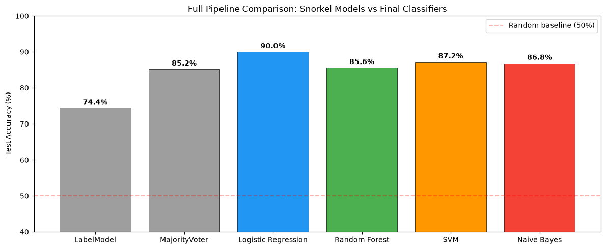
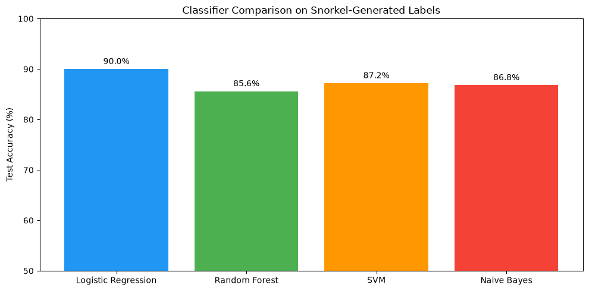
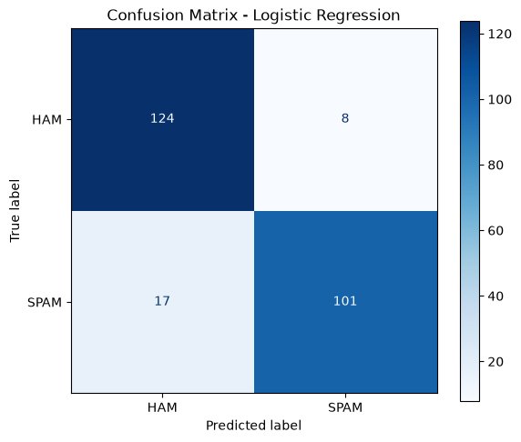
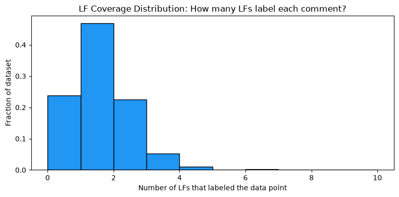
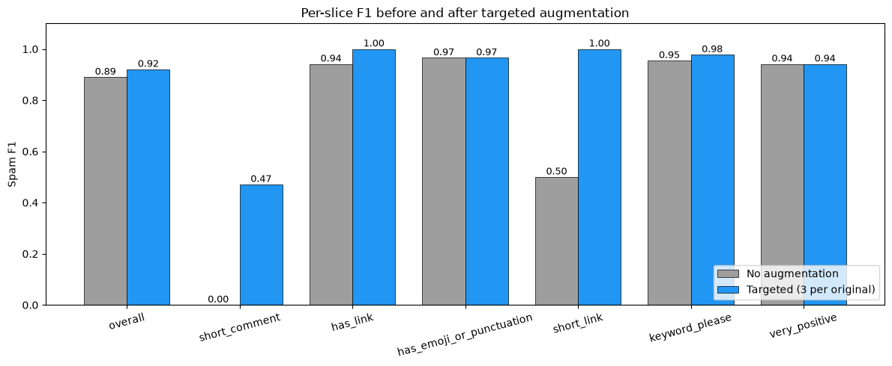

# Data Labeling Lab: Weak Supervision for YouTube Spam with Snorkel

This lab uses **Snorkel** to build a training set for classifying YouTube comments as spam or ham without hand-labeling the training data. I write **labeling functions (LFs)**, combine their noisy votes into training labels, and then train and compare four text classifiers on those labels. Finally, I use **slicing functions** to find where the classifier fails and **targeted data augmentation** to fix it, combining all three parts of the original lab into one workflow.

**Author:** Ayush Varma ([@ayushvarma7](https://github.com/ayushvarma7))
**Repository:** [github.com/ayushvarma7/youtube_spam_labeling_and_classification](https://github.com/ayushvarma7/youtube_spam_labeling_and_classification)

Based on the Snorkel spam tutorials (`reference/01_spam_tutorial.ipynb`)

---

## 1. What this project does

The dataset is the **TubeSpam** YouTube comments dataset (Alberto, Lochter, Almeida): 1,956 comments from five popular music videos, each labeled `SPAM` (1) or `HAM` (0).

| Split | Source | Size | Labels used for |
|---|---|---|---|
| Train | Videos 1 to 4 (Psy, KatyPerry, LMFAO, Eminem) | 1,586 | Nothing. Labels are hidden (set to -1) and produced by the LFs |
| Dev | Labeled sample of the training videos | 100 | Debugging LFs (checking each LF's accuracy) |
| Valid | Video 5 (Shakira) | 120 | Choosing MajorityVoter vs LabelModel, and the augmentation size |
| Test | Video 5 (Shakira) | 250 | Final scores only |

The pipeline in `spam_tutorial.ipynb`:

```mermaid
flowchart LR
    A[Unlabeled train comments] --> B[Labeling functions<br/>keyword, regex, factory, VADER, heuristic]
    B --> C[Label matrix L_train]
    C --> D[MajorityLabelVoter]
    C --> E[Snorkel LabelModel]
    D --> V{Pick best on<br/>validation set}
    E --> V
    V --> F[Filter unlabeled rows<br/>probs_to_preds]
    F --> G[TF-IDF 1 to 5-grams]
    G --> H[LogReg / Random Forest / SVM / Naive Bayes]
    H --> I[Test accuracy, confusion matrix, slice scores]
    I --> J[Slices find a blind spot:<br/>short spam]
    J --> K[Targeted TFs create<br/>short spam examples]
    K --> L[Retrain LogReg,<br/>re-score the same slices]
```



| Notebook section | What it does |
|---|---|
| 1. Loading data | Reads the five CSVs through `utils.load_spam_dataset(split_dev_valid=True)` into train, dev, valid, and test |
| 2. Writing LFs | Starts with three hand-written SPAM LFs, adds more, checks coverage, overlaps, and conflicts after each round |
| Factory LFs | One `make_keyword_lf(keywords, label)` template builds keyword LFs for both SPAM and HAM |
| 3. Regex LFs | `check.*out`, URL patterns, and `sub.*(me|to|my channel)` to catch variations the keyword rules miss |
| 4. VADER sentiment LFs | NLTK VADER compound score, first in the intuitive direction (positive means HAM) |
| Dev set check | Scores every LF against the 100 labeled dev comments; finds both VADER LFs inverted and flips them |
| LF cleanup | Drops noisy and duplicate LFs, adds a 5-word short-comment HAM rule |
| 5. Combining votes | Scores `MajorityLabelVoter` and `LabelModel` on validation and test; the validation score picks the label source |
| 6. Training classifiers | Trains four scikit-learn models on the generated labels and compares them |
| Extra analysis | LF coverage histogram, confusion matrix, classification report, full pipeline chart |
| 7. Data slicing | Three slicing functions (short comments, links, heavy punctuation) and per-slice F1 and accuracy |
| 8. Closing the loop | Three more slices, a look at the missed short spam, four targeted transformation functions, a comparison against generic augmentation and a spam-copies control, and before/after slice scores |

---

## 2. Changes I made compared to the original lab

My work is in `spam_tutorial.ipynb` at the top level. The three original notebooks are kept in `reference/` for comparison.

### Summary table

| Area | Original `01_spam_tutorial` | My `spam_tutorial` |
|---|---|---|
| LF development | Fixed set of LFs shown one by one | Iterative: write, inspect `lf_summary()`, check accuracy on a labeled dev set, drop or replace, repeat |
| Keyword LFs | 5 single-keyword LFs (`my`, `subscribe`, `http`, `please`, `song`) | Multi-keyword factory LFs, including new SPAM rules (`free`/`win`) and HAM rules (`song`/`music`/`beat`, `funny`/`lol`) |
| Regex LFs | 1 (`check.*out`) | 3 (`check.*out`, URL pattern with `.com`/`.ly`/`.net`/`.org`, `sub.*(me|to|my channel)`) |
| Sentiment LFs | TextBlob polarity and subjectivity (positive means HAM) | NLTK **VADER** compound score, **flipped**: very positive means SPAM, very negative means HAM |
| spaCy LFs | `has_person` with `SpacyPreprocessor` | Not used |
| Label aggregation | LabelModel labels used for training | Both scored; the one with higher **validation** accuracy (MajorityVoter) supplies the training labels |
| Data splits | Train and test | Train, dev (LF debugging), valid (model choice), test (final score only) |
| Featurization | `CountVectorizer(ngram_range=(1, 5))` | `TfidfVectorizer(ngram_range=(1, 5))` |
| Classifiers | Logistic Regression only | Logistic Regression, Random Forest, Linear SVM, Multinomial Naive Bayes |
| Evaluation | Single accuracy number | Accuracy per model, bar charts, confusion matrix, classification report |
| Data slicing | Separate notebook (`03_...`), and its slice-aware model is never trained (`trainer` is undefined) | Integrated, 6 slices, used to find a blind spot and then to verify the fix |
| Data augmentation | Separate notebook (`02_...`) with generic spaCy/WordNet TFs; its LSTM is never fit, so the 47.2% vs 71.6% comparison is between untrained models | 4 TFs aimed at the blind spot, compared with generic synonym TFs and a spam-copies control, all on the same Logistic Regression |
| Write-up | Tutorial text | My own analysis after every step explaining what changed and why |

### Change 1: Iterative LF development

Instead of presenting a finished LF set, the notebook shows how I got there:

1. Three SPAM LFs (`subscribe`, `http`, `check out`). No conflicts, because nothing voted HAM yet.
2. Added `my channel`, `sub me`, `follow me`. The last two covered under 1% of the data and were dropped.
3. Added HAM LFs (`song`, short comments). Conflicts appeared for the first time, which is what the LabelModel needs to learn LF accuracies.
4. Replaced the one-off LFs with a keyword factory, then added regex and VADER LFs.
5. Checked every LF against the labeled dev set (Change 3).
6. Cleaned up: removed `keyword_love` (it matches the very common word "like"), removed the keyword rules that duplicate the regex rules (`keyword_check out`, `keyword_subscribe`), and replaced the 10-word short-comment rule (57% coverage, too broad) with a 5-word version.

A helper, `get_labeling_function_summary(lfs, df)`, applies a list of LFs and returns the summary table, so each round is one line.

### Change 2: Regex LFs to recover coverage

`lf_regex_check_out` covers 23.4% of the training data compared with 21.6% for the exact `check out` keyword, because it also matches "check me out", "check it out", and "check my channel out". `lf_regex_url` covers 14.2% compared with 11.9% for the plain `http` check.

### Change 3: VADER instead of TextBlob, and a dev set check that flipped it

VADER returns a compound score from -1 to +1 and is built for short informal text. I first wrote the intuitive rules: compound > 0.8 votes HAM, compound < -0.5 votes SPAM. Coverage and conflicts looked reasonable, but scoring them on the 100 labeled dev comments showed both were wrong:

| LF | Dev accuracy before | Flipped LF | Dev accuracy after |
|---|---|---|---|
| very positive means HAM | 18% (2 of 11) | very positive means SPAM | 82% (9 of 11) |
| very negative means SPAM | 0% (0 of 6) | very negative means HAM | 100% (6 of 6) |

Spammers write upbeat messages ("Amazing song! check out my channel"), while very negative comments come from real viewers who dislike the video. The original tutorial's assumption that positive text means HAM does not hold for this data.

### Change 4: Four classifiers and TF-IDF

TF-IDF down-weights words that appear in almost every comment. The same filtered training labels train four models so they can be compared fairly.

### Change 5: Choosing the label source on a validation set

The original lab scores both label models on the test set. I load the extra validation split that `utils.load_spam_dataset` already supports and pick the label source on it, so the test set is used only for final numbers. The test set is the same 250 comments as in the original lab, so results stay comparable.

### Change 6: Evaluation beyond one accuracy number

A confusion matrix and classification report for the best model, an LF coverage histogram, a chart of the full pipeline (LabelModel, MajorityVoter, and the four classifiers), and per-slice scores with Snorkel's `Scorer.score_slices`.

### Change 7: One loop across all three original notebooks

The original lab teaches labeling (01), augmentation (02), and slicing (03) as three unrelated demos. Section 8 of my notebook uses them together:

1. **Find.** Slicing showed the classifier catches **0 of the 8** short spam comments in the test set (`adf.ly / KlD3Y`, `subscribe  my`, `Pleas subscribe my channel`, ...). The cause is in the weak labels: `lf_short_comment_5` votes HAM on every short comment, so only 54 of the 358 short training comments end up labeled SPAM, while the hidden true labels show 120 are spam.
2. **Fix.** Four transformation functions turn long spam the LFs already label well into short spam:

| TF | What it does | Example output |
|---|---|---|
| `tf_extract_link` | Keeps only the link, sometimes with a short call to action | `visit bit.ly/abc12` |
| `tf_extract_call_to_action` | Keeps only the short "subscribe / check out / visit" phrase | `check out my channel` |
| `tf_swap_shortener` | Replaces a link with a random URL-shortener link | `... tinyurl.com/7NbiQ` |
| `tf_spammer_spelling` | Misspells a spam keyword the way spammers do | `subscr1be to my chanel` |

3. **Verify.** Retrain the same Logistic Regression, pick the augmentation size on validation, and score the same slices again.

Two comparisons check that the gain comes from targeting and not just from more data. One is the generic WordNet synonym TF from the original 02 notebook. The other is a control that adds 3 plain copies of every spam comment, which shifts the class balance without adding new text.

---

## 3. Results

All numbers are test-set accuracy on the same 250 comments the original lab uses.

| Stage | Original tutorial | My first LF set | My final LF set |
|---|---|---|---|
| MajorityLabelVoter | 83.6% | 71.6% | **85.2%** |
| LabelModel | 86.4% | 54.8% | 74.4% |
| Logistic Regression | 93.2% | 82.0% | **90.0%** |
| Linear SVM | n/a | 81.6% | 87.2% |
| Multinomial Naive Bayes | n/a | 61.6% | 86.8% |
| Random Forest | n/a | 79.6% | 85.6% |
| Logistic Regression + targeted augmentation | n/a | n/a | **92.4%** |

On the validation set, MajorityVoter scores 85.8% and LabelModel 72.5%, so MajorityVoter labels are used for training. 76.2% of training comments get at least one LF vote, leaving 1,209 labeled comments for the classifiers.





### Best classifier: Logistic Regression

| Class | Precision | Recall | F1 | Support |
|---|---|---|---|---|
| HAM | 0.88 | 0.94 | 0.91 | 132 |
| SPAM | 0.93 | 0.86 | 0.89 | 118 |



### LF coverage



### Slicing and targeted augmentation

| Training set | Comments | Spam share | Valid acc | Test acc |
|---|---|---|---|---|
| No augmentation | 1,209 | 56% | 89.2% | 90.0% |
| Generic synonym TF (2 per original) | 2,377 | 60% | 89.2% | 89.6% |
| Targeted TFs (1 per original) | 1,530 | 65% | 90.0% | 90.8% |
| Targeted TFs (2 per original) | 1,891 | 72% | 90.0% | 93.2% |
| **Targeted TFs (3 per original), chosen on validation** | 2,209 | 76% | **90.8%** | **92.4%** |
| Control: 3 plain copies of each spam comment | 3,231 | 83% | 85.8% | 89.6% |

Per-slice scores on the test set, before and after targeted augmentation:

| Slice | Test comments | Spam | Accuracy before | Accuracy after | Spam F1 before | Spam F1 after |
|---|---|---|---|---|---|---|
| Overall | 250 | 118 | 90.0% | 92.4% | 0.89 | 0.92 |
| Short comment (< 5 words) | 92 | 8 | 88.0% | 90.2% | **0.00** | **0.47** |
| Has link | 18 | 18 | 88.9% | 100% | 0.94 | 1.00 |
| Heavy punctuation | 63 | 44 | 95.2% | 95.2% | 0.97 | 0.97 |
| `.ly` short link | 3 | 3 | 33.3% | 100% | 0.50 | 1.00 |
| Says "please" / "plz" | 23 | 23 | 91.3% | 95.7% | 0.96 | 0.98 |
| Very positive (VADER > 0.8) | 41 | 34 | 90.2% | 90.2% | 0.94 | 0.94 |

Short spam caught went from 0 of 8 to 4 of 8, at the cost of 2 more short HAM comments flagged (3 to 5 of 84).



### What the results show

- **Fixing the labels fixed the classifiers.** Flipping the VADER LFs, removing duplicate rules, and adding the short-comment HAM rule raised majority-vote accuracy from 71.6% to 85.2%, and the best classifier from 82.0% to 90.0%, with no change to the classifiers themselves.
- **The classifier beats its own training labels.** Logistic Regression reaches 90.0% while the labels it learned from score 85.2%, because it learns from the full comment text, not just the LF rules.
- **The LabelModel still trails majority vote.** Several of my SPAM rules fire on the same promotional comments, which breaks the LabelModel's assumption that LFs make independent errors. With only 10 LFs it cannot separate accurate rules from rules that just agree with each other.
- **Slicing found a blind spot that overall accuracy hid.** Before augmentation, the model caught none of the 8 short spam comments, yet the short-comment slice still showed 88% accuracy because 84 of its 92 comments are HAM.
- **Targeted augmentation fixed half of it without hurting other slices.** Short-spam F1 went from 0.00 to 0.47, every other slice stayed the same or improved, and overall test accuracy rose to 92.4%.
- **Targeting beats volume.** Generic synonym augmentation doubled the training set and changed nothing; plain spam copies made the model worse (89.6% test). The gain comes from the new short spam examples, not from more rows or more spam weight.
- **The very-positive slice is 83% spam** on the test set (34 of 41), which confirms on held-out data the VADER finding from the dev set.
- **Without augmentation, my best classifier is 3.2 points below the original's 93.2%.** A likely reason is HAM coverage: the original LF set also has a spaCy `has_person` rule and a broad TextBlob subjectivity rule (36% coverage), both voting HAM. With targeted augmentation the gap shrinks to 0.8 points.

---

## 4. Requirements

| Requirement | Version | Notes |
|---|---|---|
| OS | macOS or Linux | Windows users: use WSL2 |
| Python | **3.12** | Tested with the `venv` in this folder |
| snorkel | 0.10.0 | Labeling, LabelModel, slicing. Its `tie_break_policy="random"` uses a deterministic hash, so reruns give the same numbers |
| nltk | latest | VADER lexicon and WordNet are downloaded inside the notebook |
| scikit-learn, pandas, numpy, matplotlib | latest | Listed in `requirements.txt` |
| tensorflow, torch | latest | Imported by `utils.py` (torch comes with snorkel) |

---

## 5. Setup from scratch

### 5.1 Clone and create a virtual environment

```bash
git clone https://github.com/ayushvarma7/youtube_spam_labeling_and_classification.git
```

```bash
cd youtube_spam_labeling_and_classification
```

```bash
python3.12 -m venv venv
```

```bash
source venv/bin/activate
```

```bash
pip install -r requirements.txt
```

### 5.2 Register the kernel (optional)

```bash
python -m ipykernel install --user --name youtube-spam --display-name "youtube-spam (venv)"
```

### 5.3 Run the notebook

```bash
jupyter notebook spam_tutorial.ipynb
```

Select the `youtube-spam (venv)` kernel and run all cells from the top. Run it from the `youtube_spam_labeling_and_classification` folder: `utils.load_spam_dataset()` reads `data/Youtube*.csv` with a relative path.

---

## 6. Repository layout

```
youtube_spam_labeling_and_classification/
├── spam_tutorial.ipynb                             # my notebook
├── reference/                                      # original lab notebooks, unchanged
│   ├── 01_spam_tutorial.ipynb                      # labeling functions
│   ├── 02_spam_data_augmentation_tutorial.ipynb    # transformation functions
│   └── 03_spam_data_slicing_tutorial.ipynb         # slicing functions
├── utils.py                                        # dataset loader and helpers from the original lab
├── data/                                           # five TubeSpam CSV files
├── images/                                         # charts used in this README
└── requirements.txt
```

The notebooks in `reference/` import `utils.py` and read `data/` with relative paths. To rerun one, copy it to the top level first.

---

## 7. Troubleshooting

| Symptom | Cause and fix |
|---|---|
| `FileNotFoundError: data/Youtube01-Psy.csv` | Notebook started from another folder. Start Jupyter from inside `youtube_spam_labeling_and_classification` |
| `LookupError: vader_lexicon` or `wordnet` | Run `nltk.download("vader_lexicon")` and `nltk.download("wordnet")` (the notebook does both) |
| `FutureWarning: Input has data type int64` from `snorkel/labeling/analysis.py` | Harmless warning from Snorkel with newer SciPy |
| Kernel cannot import `snorkel` | Wrong kernel. Pick the `youtube-spam (venv)` kernel |
| `ConvergenceWarning: Liblinear failed to converge` for the SVM | Harmless at `C=1e3`; raise `max_iter` on `LinearSVC` to silence it |
